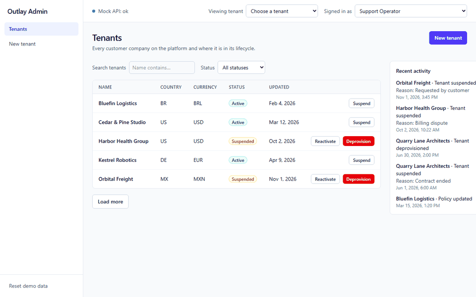
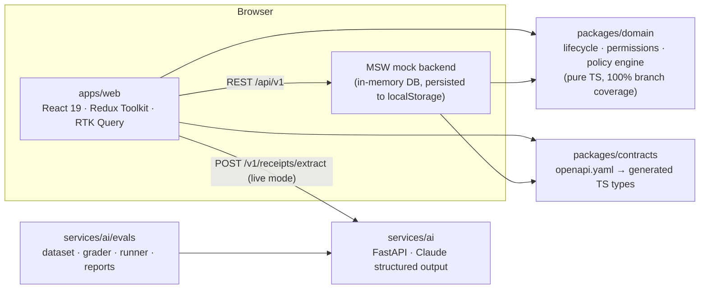

# Outlay Admin

An admin console for corporate expense programs. Support operators onboard and run customer tenants; each tenant's program admins set expense categories and spending policies, import employees, and check receipts against policy. An LLM reads the receipt; a deterministic policy engine decides whether the expense is allowed, and every decision explains itself.

**Live demo** (runs entirely in your browser, no backend, no API key): **https://joaolucasmm.github.io/outlay-admin/**



> Outlay is a fictional product. Every company, receipt and person in the demo is invented.

## What you can do in the demo

Switch identity with **Signed in as** (there is no real login, see [ADR 0002](docs/adr/0002-demo-personas-instead-of-a-role-switcher.md)).

- **As the Support Operator:** browse tenants with search, status filter and status badges; run lifecycle actions (suspend with a reason, reactivate, deprovision by typing the tenant name); onboard a new tenant with a 5-step wizard (company, locale, CSV employee import with row-level errors, review, provisioning with real, resumable steps).
- **As a Program Admin:** manage expense categories (optimistic active toggle with rollback); edit the category x role policy grid (validation, unsaved-changes guard, money in the tenant's currency); import employees from CSV; read a receipt with AI, review the fields, and see the policy check update as you edit; browse the audit log with filters and a readable before/after diff.
- A suspended tenant's program is read-only, and the mock backend enforces the same permissions as the UI (it returns 403/404/409).

## How it is built



- **Contract first.** `openapi.yaml` is the single source of truth. The web app only uses generated types, and the mock backend implements the same contract a future Spring Boot service will (M8). CI fails if the generated types are stale.
- **The LLM extracts, the policy engine decides.** The model turns a receipt into fields; a person reviews them; `checkExpense` (pure TypeScript) decides and explains each finding. Model confidence never reaches the engine ([ADR 0003](docs/adr/0003-policy-engine-judges-a-reviewed-expense.md)).
- **State:** server data lives only in RTK Query (tag invalidation, infinite queries). Redux slices hold the session and the persisted onboarding draft.

| Decision                                              | Record                                                                      |
| ----------------------------------------------------- | --------------------------------------------------------------------------- |
| Domain types come from the contract                   | [ADR 0001](docs/adr/0001-domain-types-come-from-the-contract.md)            |
| Demo personas; tenant scoping enforced by the backend | [ADR 0002](docs/adr/0002-demo-personas-instead-of-a-role-switcher.md)       |
| The policy engine judges a reviewed Expense           | [ADR 0003](docs/adr/0003-policy-engine-judges-a-reviewed-expense.md)        |
| Provisioning is real, resumable client calls          | [ADR 0004](docs/adr/0004-client-orchestrated-resumable-provisioning.md)     |
| Receipt extraction degrades instead of failing        | [ADR 0005](docs/adr/0005-receipt-extraction-degrades-instead-of-failing.md) |

Full design: [`docs/ARCHITECTURE.md`](docs/ARCHITECTURE.md) · domain glossary: [`CONTEXT.md`](CONTEXT.md) · plan and status: [`docs/ROADMAP.md`](docs/ROADMAP.md).

## Quality

- **Tests at every layer:** domain unit tests with 100% branch coverage; component and integration tests with Testing Library and MSW; Python tests with a fake LLM client (no test calls a real model); Playwright end-to-end tests against the production build under the Pages base path.
- **Accessibility:** axe (WCAG 2.1 A/AA) scans every main screen and dialog in CI and fails on serious or critical issues; keyboard tests cover the skip link, focus trapping, focus return after closing a dialog, and completing actions without a mouse.
- **Every list and page** has loading, empty and error states; a route error boundary replaces a crash with a way out.
- **CI** runs lint, typecheck, unit tests, build, contract-type freshness, Python ruff/mypy/pytest, and the end-to-end suite. Every push to `main` deploys the demo.

## AI receipt extraction, measured

`services/ai` reads a receipt image with Claude through structured output (a Pydantic schema), retries once on unusable output, and otherwise returns low confidence with null fields: it never fails on bad model output ([ADR 0005](docs/adr/0005-receipt-extraction-degrades-instead-of-failing.md)).

It is evaluated on 30 seeded synthetic receipts (10 dev, 20 test) built to break extractors: ambiguous `dd/mm` vs `mm/dd` dates, `$` meaning MXN, thousands separators, tips and discounts, cash and change lines, and unreadable receipts whose right answer is null. Grading is per field and programmatic, with no LLM judge.

| Test split, 20 cases x 3 reps | Field accuracy | Cost / receipt | p50 latency |
| ----------------------------- | -------------- | -------------- | ----------- |
| `claude-opus-5-5`, prompt v1  | 94.7% ± 5.8    | $0.0072        | 2.1 s       |
| `claude-opus-5-5`, prompt v2  | 97.7% ± 4.6    | $0.0090        | 2.0 s       |
| `claude-haiku-5-5`, prompt v2 | 99.0% ± 2.0    | $0.0002        | 1.2 s       |

Read honestly: neither gain clears the 95% interval on 20 cases, and v2 has a regression the report documents. The run also found and fixed a bug in the eval itself (its "unreadable" receipts were readable). Report: [`services/ai/evals/reports/2026-11-15-v1-vs-v2.md`](services/ai/evals/reports/2026-11-15-v1-vs-v2.md) · how the eval works: [`services/ai/evals/README.md`](services/ai/evals/README.md).

## Run it locally

Requirements: Node 22 with pnpm 9 (`corepack enable`), and for the AI service Python 3.12+ with [uv](https://docs.astral.sh/uv/).

```bash
pnpm i
pnpm dev                                      # http://localhost:5173/outlay-admin/ (mock mode)
pnpm lint && pnpm typecheck && pnpm test      # what CI runs for TypeScript
pnpm e2e                                      # Playwright against the production build
```

AI service and evals:

```bash
cd services/ai
uv sync && uv run ruff check . && uv run mypy && uv run pytest
uv run fastapi dev app/main.py                # live extraction; needs ANTHROPIC_API_KEY in services/ai/.env
```

Point the web app at it with `VITE_AI_MODE=live VITE_AI_URL=http://localhost:8000 pnpm dev`. Environment variables are documented in [`.env.example`](.env.example). The demo GIF is regenerated with `CAPTURE_DEMO=1 pnpm --filter web exec playwright test demo`, then `uv run python ../../scripts/make_demo_gif.py` from `services/ai`.

## Repository layout

```
apps/web/            React app (features/<feature>/, shared/ui, mocks/ for MSW, e2e/ for Playwright)
packages/contracts/  openapi.yaml + generated types
packages/domain/     pure TypeScript: lifecycle, permissions, policy engine, validation
services/ai/         FastAPI receipt extraction + evals/
docs/                architecture, roadmap, ADRs, media
```

## What I'd do next

- **Spring Boot tenant API (M8):** implement the same `openapi.yaml` with Spring Boot 3, Java 21 and MySQL, port the lifecycle tests to JUnit, add a contract test, and switch the web app with `VITE_API_MODE=live`.
- **Evals:** add real anonymized receipt photos, grow the set so a few points of difference are measurable, write a v3 prompt from new dev cases that fixes v2's regression, and only then consider making `claude-haiku-5-5` the default.
- **Product:** pick a specific employee (not just a role) when checking a receipt, export the filtered audit log as CSV, and support PDF receipts.
- **Production concerns the demo skips:** real authentication and per-user audit actors, server-side rate limiting, and observability for the AI service.
