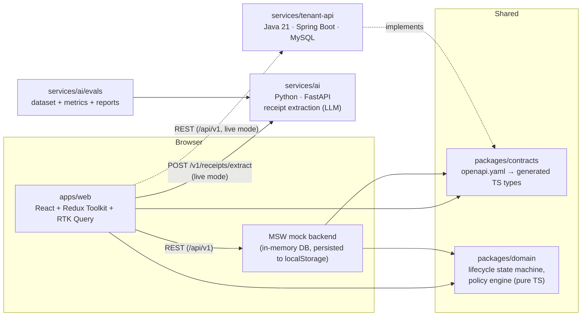
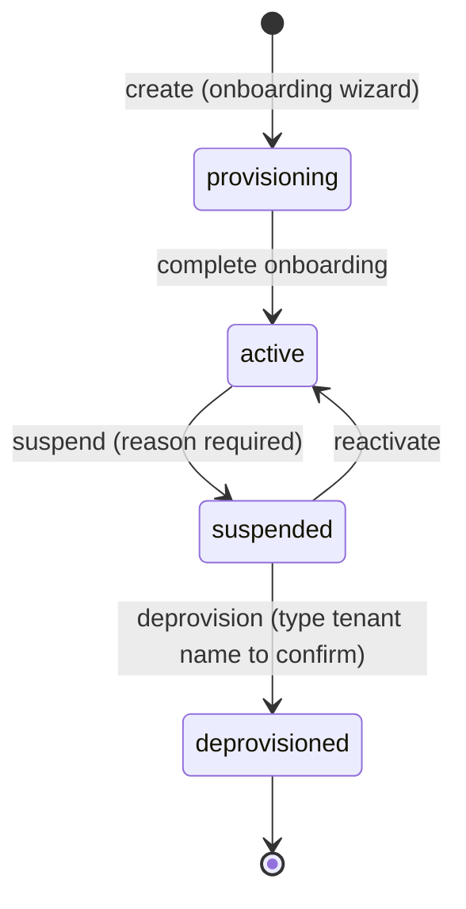

# Outlay Admin — Architecture

Outlay Admin is an **admin console for corporate expense programs**: support operators provision and manage customer tenants, and each tenant's program admins configure expense categories, spending policies and approval rules, onboard employees, and check receipts against policy with an LLM-powered extraction service.

It is a portfolio project. The goal is to show production-style engineering on a small surface: typed contracts, a real state model, tests at every layer, CI/CD, and an AI feature that is **measured**, not just demoed.

> "Outlay" is a fictional product. No real brand names, logos or visual identity are used.

---

## 1. System overview



### Key design decisions

| Decision | Why |
|---|---|
| **Contract-first API** (`openapi.yaml` is the source of truth) | The MSW mock and the future Spring Boot service implement the same contract, so the frontend never changes when the real backend arrives. |
| **Domain logic in a pure TS package** | The tenant lifecycle and the policy engine are deterministic, so they are unit-tested in isolation and reused by both the UI and the mock backend. |
| **The LLM extracts, the rules decide** | The model only turns a receipt image into structured fields. Compliance is decided by the deterministic policy engine, which keeps decisions explainable, testable and cheap. |
| **Mock mode by default** | The GitHub Pages demo runs fully in the browser (MSW + fixture extractions). No API key is ever shipped to the client. Live mode talks to the local Python service. |
| **Redux Toolkit for client state, RTK Query for server state** | Session, permissions and the onboarding draft are real client state; everything else is cached server state with tag-based invalidation. |
| **Feature-based folders** | Each feature owns its API endpoints, components, state and tests. |

---

## 2. Repository layout

pnpm workspaces monorepo (Node 22, pnpm 9). Python uses `uv`.

```
outlay-admin/
├── CLAUDE.md
├── README.md                   # pitch, GIF, live demo link, decisions
├── docs/
│   ├── ARCHITECTURE.md
│   ├── ROADMAP.md
│   └── adr/                    # short ADRs: 0001-contract-first.md, ...
├── apps/
│   └── web/                    # Vite + React + TS
├── packages/
│   ├── contracts/              # openapi.yaml + generated types
│   └── domain/                 # pure TS: types, lifecycle, policy engine
├── services/
│   ├── ai/                     # FastAPI receipt extraction + evals
│   └── tenant-api/             # Spring Boot: tenants, lifecycle, audit, program
├── .github/workflows/
│   ├── ci.yml                  # TS, e2e, Python, Java (+ Compose smoke)
│   └── deploy.yml              # web → GitHub Pages (mock mode)
├── pnpm-workspace.yaml
└── package.json
```

---

## 3. Domain model

All money is stored as **integer minor units** (cents) plus an ISO 4217 currency code. Dates are ISO 8601 strings.

```ts
type TenantStatus = 'provisioning' | 'active' | 'suspended' | 'deprovisioned';

interface Tenant {
  id: string; name: string; country: string;      // ISO 3166-1 alpha-2
  currency: string; status: TenantStatus;
  createdAt: string; updatedAt: string;
}

type EmployeeRole = 'employee' | 'manager' | 'director';

interface ExpenseCategory {
  id: string; tenantId: string; code: string;     // e.g. "MEALS"
  name: string; glAccount?: string; active: boolean;
}

interface PolicyRule {
  id: string; tenantId: string; categoryId: string;
  role: EmployeeRole;
  limitMinor: number;                 // max per expense
  receiptRequiredAboveMinor: number;  // receipt mandatory above this
  approvalLevels: 0 | 1 | 2;          // 0 = auto-approve
}

interface Employee {
  id: string; tenantId: string; name: string; email: string;
  role: EmployeeRole; costCenter: string;
}

interface AuditEvent {
  id: string; tenantId: string | null;
  actor: { id: string; role: AdminRole };
  action: string;                     // "tenant.suspended", "policy.updated", ...
  entity: string; entityId: string;
  before?: unknown; after?: unknown; at: string;
}

interface ReceiptExtraction {
  merchant: string | null; date: string | null;
  totalMinor: number | null; currency: string | null;
  suggestedCategoryCode: string | null;
  confidence: 'high' | 'medium' | 'low';
  model: string; promptVersion: string; latencyMs: number;
}

interface PolicyCheckResult {
  status: 'compliant' | 'needs_approval' | 'violation';
  findings: { code: string; message: string; severity: 'info' | 'warn' | 'error' }[];
  requiredApprovalLevels: number;
}
```

### Tenant lifecycle (state machine in `packages/domain`)



- `transition(tenant, action, actor)` returns `Result<Tenant, TransitionError>` and never throws.
- Only the `support_operator` role may run lifecycle actions.
- Every successful transition emits an `AuditEvent`.
- A tenant that is not `active` is read-only for program admins.

### Policy engine (`checkExpense`)

Input: `{ expense, categoryCode, employeeRole, tenantCurrency, categories, rules }`, where `expense` is a reviewed **Expense** (`amountMinor`, `currency`, `receipt: readable | unreadable | missing`), never the raw extraction ([ADR 0003](adr/0003-policy-engine-judges-a-reviewed-expense.md)). Output: `PolicyCheckResult`. Money in messages is formatted by an injected `formatMoney`.

Checks, in order (all applicable checks run; the worst severity decides the status):
1. The expense currency differs from the tenant currency → `violation` (amount checks are skipped).
2. The category is unknown (stop) or inactive → `violation`.
3. There is no rule for the category × Employee Role → `violation` (`no_policy`, stop).
4. The amount is above the role limit → `violation`.
5. The amount is above the receipt threshold and the receipt is missing or unreadable → `violation`.
6. `approvalLevels > 0` → `needs_approval`.
7. Otherwise → `compliant`.

Each rule produces an explainable finding. The engine has 100% branch coverage.

---

## 4. Roles & permissions

| Role | Scope | Can |
|---|---|---|
| `support_operator` (vendor side) | all tenants | list, create and onboard tenants, run lifecycle actions, view all audit logs |
| `program_admin` (customer side) | one tenant | manage categories, policies and employees, check receipts, view their own audit log |

There is no real login in the demo: a "Signed in as" **persona** picker in the header (the Support Operator, or the Program Admin of one tenant) sets the Redux `session` slice, and the persona id travels to the backend in an `X-Demo-Persona` header (see [ADR 0002](adr/0002-demo-personas-instead-of-a-role-switcher.md)). The permission table lives in `packages/domain` (`can(role, permission)`): route guards use it in the UI, and the mock backend enforces the same table (403) and scopes data to the persona's tenant.

---

## 5. Frontend (`apps/web`)

**Stack:** Vite · React 19 · TypeScript (strict) · Redux Toolkit + RTK Query · React Router · react-hook-form + zod · Tailwind CSS · Radix primitives (shadcn/ui style) · TanStack Table · Papaparse (CSV) · MSW · Vitest + Testing Library · Playwright.

```
apps/web/src/
├── app/
│   ├── store.ts              # configureStore, typed hooks
│   ├── api.ts                # RTK Query base api (createApi, tagTypes)
│   ├── router.tsx            # routes + guards
│   └── providers.tsx
├── features/
│   ├── session/              # slice: persona, currentTenantId; useCan(), guards
│   ├── tenants/              # list, detail, lifecycle actions
│   ├── onboarding/           # wizard + draft slice (persisted)
│   ├── categories/
│   ├── policies/             # rules grid by category × role
│   ├── employees/
│   ├── receipts/             # upload → extract → policy check
│   └── audit/
│       └── (each: api.ts · components/ · pages/ · *.test.tsx)
├── shared/
│   ├── ui/                   # Button, Dialog, DataTable, StatusBadge, EmptyState...
│   ├── lib/                  # money formatting (Intl), dates, ids
│   └── hooks/
└── mocks/
    ├── browser.ts / node.ts  # MSW setup (browser for the demo, node for tests)
    ├── db.ts                 # in-memory store, seeded, localStorage persistence
    ├── handlers/             # one file per resource, typed with contract types
    └── fixtures/             # seed tenants + receipt extraction fixtures
```

### Routes

| Path | Role | Screen |
|---|---|---|
| `/tenants` | operator | tenant table: status badges, search, status filter, lifecycle actions |
| `/tenants/new` | operator | onboarding wizard |
| `/t/:tenantId/categories` | admin | CRUD categories, toggle active |
| `/t/:tenantId/policies` | admin | grid of category × role with limits, receipt threshold and approval levels; inline edit with dirty-state warning |
| `/t/:tenantId/employees` | admin | table + CSV import |
| `/t/:tenantId/receipts` | admin | upload receipt → extracted fields (editable) → policy check result |
| `/t/:tenantId/audit` | both | audit log filtered by actor, action, entity and date range (filters live in the URL); a side drawer shows the before/after diff with readable labels and money in the tenant currency |

### Onboarding wizard

Steps, each at its own URL (`/tenants/new/:step`): **Company** (name, country) → **Locale** (currency, Standard or Empty category template) → **Employees** (optional CSV upload with row-level validation errors, a downloadable error report and a valid-rows preview) → **Review** → **Provision**. A deep link to a step whose earlier steps are incomplete redirects to the first incomplete one.

Provisioning makes four real API calls, each shown with its status: create the tenant (`provisioning`) → apply the template → import employees → activate ([ADR 0004](adr/0004-client-orchestrated-resumable-provisioning.md)). Completed calls are recorded in the draft, so Retry resumes where it failed and never creates the tenant twice. The Support Operator may write to a tenant's program only while it is `provisioning`.

The draft lives in the `onboarding` slice and is persisted to localStorage, so a refresh doesn't lose work. CSV parsing (Papaparse, auto-detected `,`/`;`, BOM-safe) happens in the browser; row rules come from the domain (`validateEmployeeImport`) and the server re-checks them.

### State rules

- Server data only lives in RTK Query, never copied into slices.
- Mutations invalidate tags (`Tenant`, `Category`, `Policy`, `Employee`, `Audit`).
- Optimistic update only for the category active toggle, with rollback on error.
- Every list has loading, empty and error states.

### Modes

`VITE_API_MODE=mock` (default; enables MSW in the browser) or `live` with `VITE_API_URL` (services/tenant-api, see §8), and `VITE_AI_MODE=mock|live`.
- `mock`: MSW answers `/v1/receipts/extract` on the same origin with fixtures for the sample receipts in `public/sample-receipts/` (drawn by `services/ai/evals/generate_receipts.py`), with simulated latency. Any other file gets an honest low-confidence answer.
- `live`: `POST {VITE_AI_URL}/v1/receipts/extract`. Same calling code; MSW lets the request through.
- With a live tenant API and mocked AI, MSW starts with the receipt handlers only and lets every other request through.

The `/t/:tenantId/receipts` screen: upload or pick a sample, then review editable fields (marked where the AI filled them, with the confidence). The reviewer picks the employee role and confirms the receipt is legible, and `checkExpense` runs in the browser on the reviewed Expense, updating as the fields change.

---

## 6. Contracts (`packages/contracts`)

- `openapi.yaml` (OpenAPI 3.1) under `/api/v1`: tenants (+ `POST /tenants/{id}/transitions`), demo personas and reset (mock only), categories, policies, onboarding (`POST /tenants`, `POST /tenants/{id}/program:apply-template`), employees (+ `POST /tenants/{id}/employees:import`), audit-events (filters: `actorId`, `action`, `entity`, `from`, `to`). Plus the AI service: `POST /v1/receipts/extract`.
- Errors use RFC 9457 Problem Details (`type`, `title`, `status`, `detail`, `errors[]`).
- List endpoints use cursor pagination (`?cursor=&limit=`) and return `{ items, nextCursor }`.
- `pnpm --filter contracts generate` runs `openapi-typescript`, and the output is committed. CI fails if the generated file is stale.

---

## 7. AI service (`services/ai`)

**Stack:** Python 3.12 · FastAPI · Pydantic v2 · Anthropic Python SDK · uv · ruff · pytest.

```
services/ai/
├── app/
│   ├── main.py               # FastAPI app, CORS for local web
│   ├── api/receipts.py       # POST /v1/receipts/extract (multipart image)
│   ├── extraction/
│   │   ├── extractor.py      # calls the LLM, validates with Pydantic
│   │   ├── prompts/v1.md     # baseline prompt
│   │   ├── prompts/v2.md     # improved prompt (date/currency normalization rules)
│   │   └── schema.py         # ReceiptExtraction model = tool/JSON schema
│   └── settings.py           # MODEL_ID, PROMPT_VERSION, ANTHROPIC_API_KEY (env)
├── evals/
│   ├── generate_receipts.py  # synthetic receipts (Pillow) from random ground truth
│   ├── dataset/              # images + labels.jsonl
│   ├── run.py                # runs prompt versions, computes metrics
│   └── reports/              # committed markdown reports
└── tests/                    # unit tests with a fake LLM client (no network)
```

- **Structured output:** `client.beta.messages.parse` with the `ModelReceipt` Pydantic model as `output_format`, so the JSON matches the schema by construction. Pydantic and `normalize.py` then validate meaning: an ISO date, an ISO 4217 currency, a total converted to minor units by the service (the model returns it as printed text), and a category from the hinted list. Invalid output, a refusal or `max_tokens` gets one retry, then the service returns `confidence: "low"` with null fields and `notes`. It never returns a 500 for bad model output; provider outages are 502/503 ([ADR 0005](adr/0005-receipt-extraction-degrades-instead-of-failing.md)).
- **The model is configurable** through `MODEL_ID` (default `claude-opus-5-5`) and `EFFORT` (default `low`). M6 compares models on the eval set. Requests opt into server-side refusal fallbacks, and the response's `model` field reports which model answered.
- **Input:** multipart `image` (JPEG/PNG/WebP, checked by magic bytes, up to 5 MB, downscaled to 1568 px on the long side) plus `categories`, the tenant's active categories, so the model can suggest one of them.
- **No secrets in the repo.** `.env.example` documents the variables.
- **The LLM client sits behind an interface,** so tests use a fake client and CI never calls the API.

### Evals

See [`services/ai/evals/README.md`](../services/ai/evals/README.md). The dataset is 30 seeded synthetic receipts (10 `dev`, 20 `test`, split at random within each difficulty), with ground truth from the generator, never from a model. Each case targets one difficulty: clean, ambiguous `dd/mm` vs `mm/dd` dates, tips/tax/discount, cash and change lines, thousands separators, `$` meaning MXN, low contrast, and unreadable receipts whose right answer is null. Real anonymized photos are still to be added.

Grading is programmatic, per field: merchant fuzzy ≥ 0.9 after normalizing; date, total in minor units, currency and category exact. An invented value where the answer is null counts as a hallucination. Each variant (model × prompt) runs through the service's real `Extractor` with resume, a per-case wall-clock ceiling, jittered backoff, an `errors.jsonl` sidecar (provider errors, timeouts, a different served model: never scored as zero) and a harness-integrity gate the user approves.

`uv run python -m evals.run --variant <name> --model <id> --prompt <v>` writes `evals/runs/<variant>/`; `uv run python -m evals.report` writes `evals/reports/<date>-*.md`: field accuracy with a 95% CI, per-field rates, hallucinations, valid-output rate, p50/p95 latency, measured cost per receipt, a paired bootstrap comparison against the baseline, and the worst cases. Prompt changes are written from `dev` failures only; claims are made on `test`. The README links the latest report.

---

## 8. Tenant API (`services/tenant-api`)

Spring Boot 3.5 · Java 21 · Spring Web · Spring Security · Spring Data JPA · Flyway · MySQL 8.4 · JUnit 5 + Testcontainers · Docker Compose (`compose.yaml` at the root).

**Scope:** every admin endpoint of the contract: health, demo personas and reset, tenants (list, get, create), lifecycle transitions, the audit log with its filters (M8), and the tenant program: categories, the policy grid, employees with all-or-nothing import, and the onboarding template (M8b). Only receipt extraction lives elsewhere (`services/ai`).

```
api/ (generated)   openapi-generator, interfaceOnly: TenantsApi, AuditApi, ... + DTOs
web/               controllers implement the generated interfaces; Problem Details; keyset cursors
service/           TenantService, CategoryService, PolicyRuleService, EmployeeService,
                   TemplateService, ProgramGuard, AuditLog, DemoSeed
domain/            pure Java: Lifecycle, Permission, NewTenant, ProgramAccess, CategoryFields,
                   PolicyRuleFields, EmployeeImport, CategoryTemplate, Result (no Spring)
persistence/       JPA entities + Spring Data repositories
security/          Caller, DemoPersonaFilter (demo profile), SecurityConfig
```

- **Contract first, in Java too.** The Maven build generates the API interfaces and DTOs from `packages/contracts/openapi.yaml`; controllers implement them, so a path, parameter or field that drifts from the contract fails to compile.
- **One set of rules, two implementations.** `packages/domain/fixtures/` holds the rules as data: `lifecycle-cases.json` (transitions, permissions), `program-cases.json` (program write access, category, policy-rule and employee validation, imports, the template with its ids) and `category-template.json` (the standard template itself, which the Maven build packages). Vitest and parameterized JUnit tests run every case, with exact messages.
- **Authentication is one filter** ([ADR 0006](adr/0006-demo-persona-header-is-a-spring-security-filter.md)): `X-Demo-Persona` is resolved by `DemoPersonaFilter` in the `demo` profile; `@PreAuthorize` and tenant scoping do not know where the caller came from.
- **Persistence:** Flyway owns the schema (`db/migration`); Hibernate only validates it. The demo seed (`db/demo/R__demo_seed.sql`, `demo` profile only) is generated from the web mock's fixtures by `pnpm seed:export`, and CI fails if it is stale ([ADR 0007](adr/0007-the-java-demo-seed-is-generated-from-the-mock.md)); `POST /demo/reset` re-runs it. Audit `before`/`after` are JSON columns. Tenant names are unique through a normalized `name_key` index, and a `@Version` column turns a concurrent lifecycle action into 409 instead of a lost update. Program writes lock the tenant row (`SELECT … FOR UPDATE`), so the status they checked cannot change before they commit; the policy grid is replaced whole and the last save wins (the contract has no ETag). Unique indexes back every "already exists" rule: tenant name, category code per tenant, employee email per tenant.
- **Pagination:** opaque keyset cursors (base64url JSON of the last row's sort key): `(name, id)` for tenants and employees, `(code, id)` for categories, `(at, id)` newest first for audit events, each backed by an index.
- **Request bodies are strict:** a field the contract does not have, or a value outside an enum, is a 422 that points at it (`employees[3].role`). Generated DTOs use `JsonNullable`, so a PATCH tells an absent field from an explicit `null`.
- **Errors:** RFC 9457 Problem Details with the mock's statuses, titles and messages (400/401/403/404/409/422).
- **Tests:** domain unit tests (shared fixture); `*IT` integration tests against MySQL in Testcontainers, where every response is validated against `openapi.yaml` (status documented, body matches the schema); `ParityIT` and `ProgramParityIT` repeat the MSW handler test scenarios. CI also builds the Docker image, smoke-tests `docker compose up`, and runs the Playwright main flow (onboard, set a policy, check a receipt) against it with `E2E_API=live`.

Optional after that (M9): Kubernetes manifests (kind) with health probes and Actuator metrics.

---

## 9. Quality bar

- TypeScript `strict`, no `any`, ESLint + Prettier. Python: ruff (lint + format), and mypy on `app/`.
- **Tests:**
  - domain: unit tests, 100% branch coverage;
  - web: component and integration tests with MSW (node);
  - one Playwright smoke test of the main flow (onboard tenant → set policy → check receipt);
  - Python: pytest with a fake LLM.
- **Accessibility:** keyboard-navigable dialogs and tables, labelled inputs, visible focus.
- **CI** (`ci.yml`, on PRs and main):
  - pnpm install;
  - contract types up to date;
  - lint, typecheck and test for all TS packages;
  - web build;
  - ruff + pytest for `services/ai`;
  - `./mvnw verify` for `tenant-api` (unit, Testcontainers, contract) and a Docker Compose smoke test.
- **Deploy** (`deploy.yml`, on main): build web with `VITE_API_MODE=mock` and `VITE_AI_MODE=mock`, base `/outlay-admin/`, copy `index.html` to `404.html` for SPA routing, and register the MSW worker with the base path. Publishes to GitHub Pages.
- **Docs:** README in English with a one-paragraph pitch, demo link + GIF, an architecture diagram, how to run it, links to the decisions/ADRs and to the eval report, and a "what I'd do next" section.
