# Receipt extraction eval: dataset

Generated by `uv run python -m evals.generate_receipts --dataset` (seeded, so it is
reproducible). Ground truth comes from the generator, never from a model. `null`
means the right answer is to return null (the receipt is unreadable).

**30 cases**: 10 dev, 20 test. By difficulty: clean 5, ambiguous_date 5, tip_discount 5, cash_change 4, thousands 4, dollar_mx 3, low_contrast 2, unreadable 2.

| id | split | difficulty | locale | merchant | date | total (minor) | currency | category |
|---|---|---|---|---|---|---|---|---|
| [rcpt-001](#rcpt-001) | test | clean | BR | Pousada Mar Azul | 2026-06-16 | 22360 | BRL | LODGING |
| [rcpt-002](#rcpt-002) | test | clean | US | Metro Cab Co. | 2026-05-16 | 10400 | USD | TRAVEL |
| [rcpt-003](#rcpt-003) | dev | clean | PT | Papelaria Central | 2026-02-22 | 2850 | EUR | OFFICE |
| [rcpt-004](#rcpt-004) | dev | clean | DE | Gasthaus Lindenhof | 2026-02-26 | 1580 | EUR | MEALS |
| [rcpt-005](#rcpt-005) | test | clean | MX | Hotel Casa Coral | 2026-10-26 | 302760 | MXN | LODGING |
| [rcpt-006](#rcpt-006) | test | ambiguous_date | BR | Taxi Rapido Cooperativa | 2026-07-04 | 36730 | BRL | TRAVEL |
| [rcpt-007](#rcpt-007) | test | ambiguous_date | US | Paper Trail Supply | 2026-07-10 | 2450 | USD | OFFICE |
| [rcpt-008](#rcpt-008) | dev | ambiguous_date | US | Copper Kettle Cafe | 2026-08-02 | 3000 | USD | MEALS |
| [rcpt-009](#rcpt-009) | test | ambiguous_date | BR | Pousada Mar Azul | 2026-10-04 | 130360 | BRL | LODGING |
| [rcpt-010](#rcpt-010) | dev | ambiguous_date | MX | Autobuses del Sol | 2026-03-10 | 104580 | MXN | TRAVEL |
| [rcpt-011](#rcpt-011) | dev | tip_discount | BR | Papelaria Ponto Final | 2026-07-17 | 6700 | BRL | OFFICE |
| [rcpt-012](#rcpt-012) | dev | tip_discount | US | Bluebird Diner | 2026-01-28 | 1278 | USD | MEALS |
| [rcpt-013](#rcpt-013) | test | tip_discount | PT | Hotel Miradouro | 2026-02-25 | 14155 | EUR | LODGING |
| [rcpt-014](#rcpt-014) | test | tip_discount | DE | Stadttaxi Nord | 2026-09-19 | 9900 | EUR | TRAVEL |
| [rcpt-015](#rcpt-015) | test | tip_discount | US | Paper Trail Supply | 2026-05-27 | 4029 | USD | OFFICE |
| [rcpt-016](#rcpt-016) | test | cash_change | BR | Padaria Pao de Ouro | 2026-01-15 | 13090 | BRL | MEALS |
| [rcpt-017](#rcpt-017) | test | cash_change | US | Harbor Inn | 2026-10-22 | 17400 | USD | LODGING |
| [rcpt-018](#rcpt-018) | dev | cash_change | MX | Autobuses del Sol | 2026-02-23 | 102750 | MXN | TRAVEL |
| [rcpt-019](#rcpt-019) | test | cash_change | PT | Papelaria Central | 2026-07-13 | 1900 | EUR | OFFICE |
| [rcpt-020](#rcpt-020) | test | thousands | BR | Hotel Serra Verde | 2026-08-14 | 912750 | BRL | LODGING |
| [rcpt-021](#rcpt-021) | dev | thousands | US | Redwood Lodge | 2026-07-22 | 185750 | USD | LODGING |
| [rcpt-022](#rcpt-022) | test | thousands | DE | Hotel Am Stadtpark | 2026-05-26 | 177200 | EUR | LODGING |
| [rcpt-023](#rcpt-023) | test | thousands | MX | Hotel Casa Coral | 2026-03-24 | 2928050 | MXN | LODGING |
| [rcpt-024](#rcpt-024) | test | dollar_mx | MX | Taqueria El Faro | 2026-03-13 | 47000 | MXN | MEALS |
| [rcpt-025](#rcpt-025) | dev | dollar_mx | MX | Hotel Casa Coral | 2026-03-14 | 151430 | MXN | LODGING |
| [rcpt-026](#rcpt-026) | test | dollar_mx | MX | Autobuses del Sol | 2026-07-24 | 19950 | MXN | TRAVEL |
| [rcpt-027](#rcpt-027) | test | low_contrast | BR | Papelaria Ponto Final | 2026-04-18 | 15100 | BRL | OFFICE |
| [rcpt-028](#rcpt-028) | dev | low_contrast | US | Bluebird Diner | 2026-02-13 | 950 | USD | MEALS |
| [rcpt-029](#rcpt-029) | test | unreadable | BR | null | null | null | null | null |
| [rcpt-030](#rcpt-030) | test | unreadable | US | null | null | null | null | null |

## rcpt-001

*Baseline: everything printed plainly.*

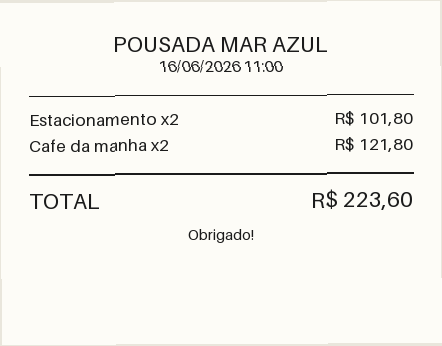

## rcpt-002

*Baseline: everything printed plainly.*

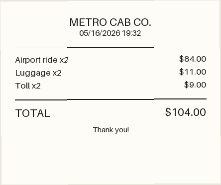

## rcpt-003

*Baseline: everything printed plainly.*

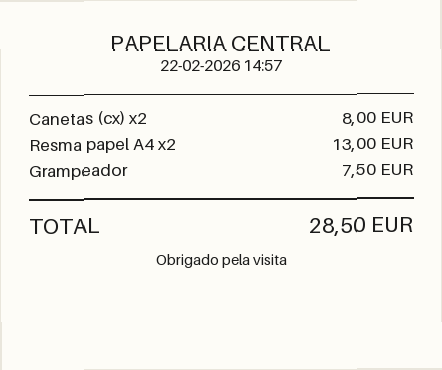

## rcpt-004

*Baseline: everything printed plainly.*

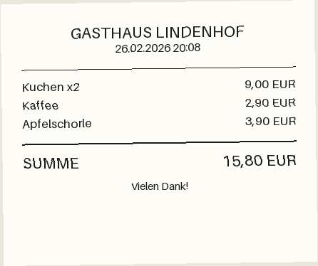

## rcpt-005

*Baseline: everything printed plainly.*

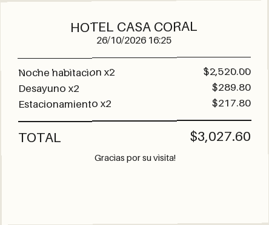

## rcpt-006

*Day and month are both <= 12; only the locale tells dd/mm from mm/dd.*

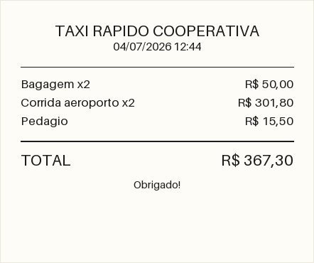

## rcpt-007

*Day and month are both <= 12; only the locale tells dd/mm from mm/dd.*

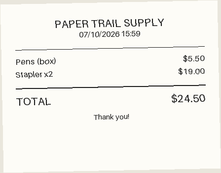

## rcpt-008

*Day and month are both <= 12; only the locale tells dd/mm from mm/dd.*

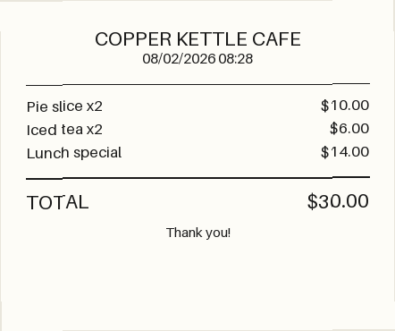

## rcpt-009

*Day and month are both <= 12; only the locale tells dd/mm from mm/dd.*

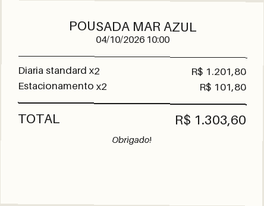

## rcpt-010

*Day and month are both <= 12; only the locale tells dd/mm from mm/dd.*

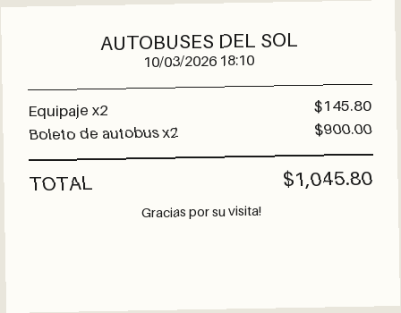

## rcpt-011

*The total differs from the subtotal (tax, tip or discount).*

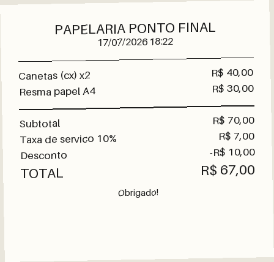

## rcpt-012

*The total differs from the subtotal (tax, tip or discount).*

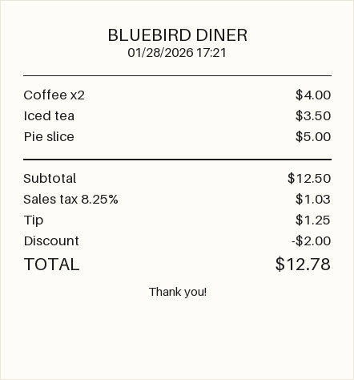

## rcpt-013

*The total differs from the subtotal (tax, tip or discount).*

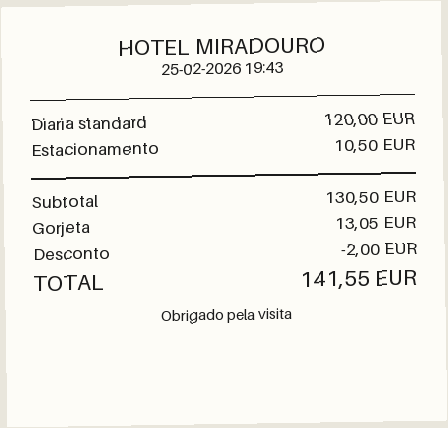

## rcpt-014

*The total differs from the subtotal (tax, tip or discount).*

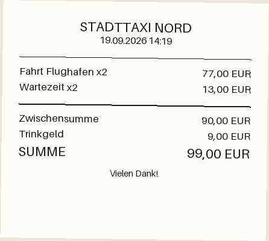

## rcpt-015

*The total differs from the subtotal (tax, tip or discount).*

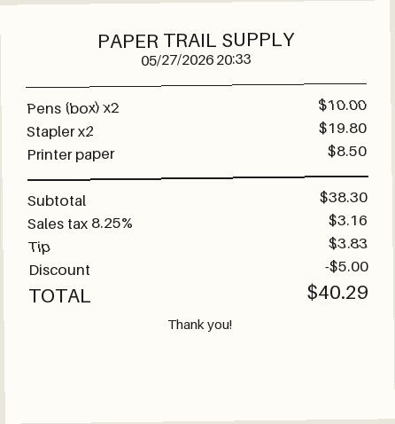

## rcpt-016

*Cash paid and change are printed and are larger than the total.*

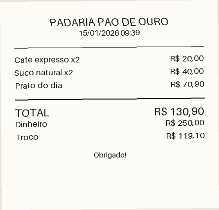

## rcpt-017

*Cash paid and change are printed and are larger than the total.*

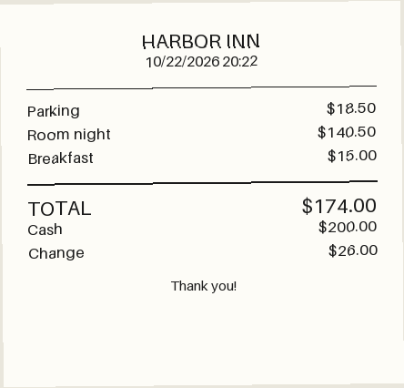

## rcpt-018

*Cash paid and change are printed and are larger than the total.*

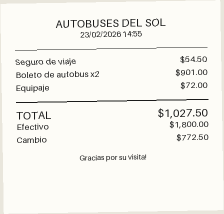

## rcpt-019

*Cash paid and change are printed and are larger than the total.*

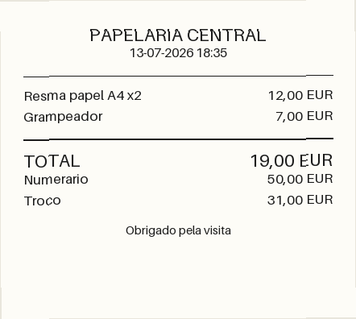

## rcpt-020

*The total uses a thousands separator (1.234,56 vs 1,234.56).*

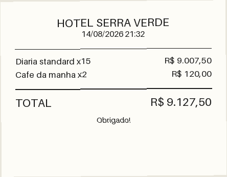

## rcpt-021

*The total uses a thousands separator (1.234,56 vs 1,234.56).*

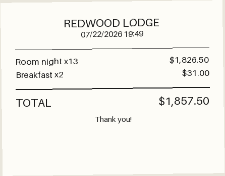

## rcpt-022

*The total uses a thousands separator (1.234,56 vs 1,234.56).*

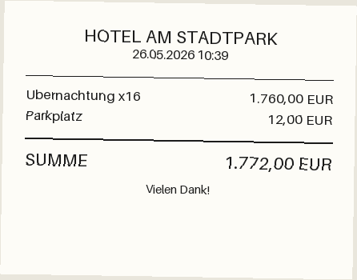

## rcpt-023

*The total uses a thousands separator (1.234,56 vs 1,234.56).*

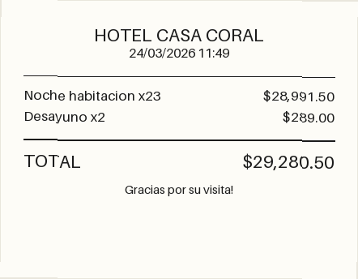

## rcpt-024

*Mexican receipt: '$' means MXN, not USD.*

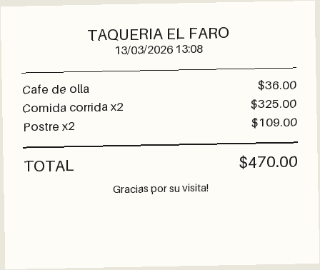

## rcpt-025

*Mexican receipt: '$' means MXN, not USD.*

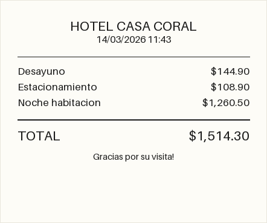

## rcpt-026

*Mexican receipt: '$' means MXN, not USD.*

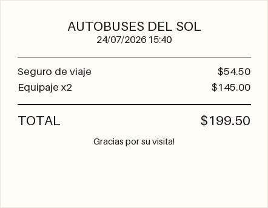

## rcpt-027

*Faded ink and a slight blur, but still legible.*

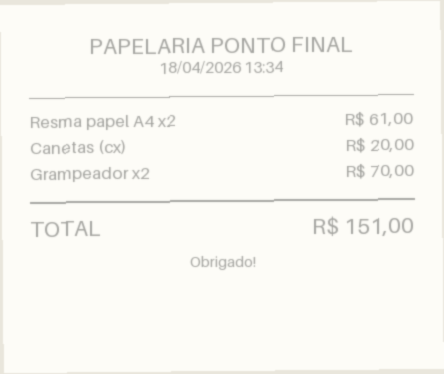

## rcpt-028

*Faded ink and a slight blur, but still legible.*

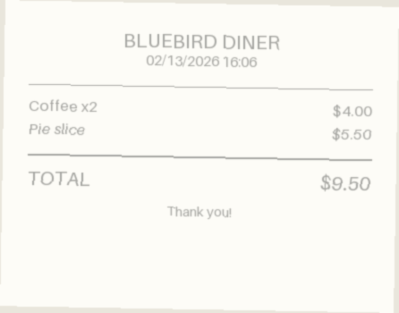

## rcpt-029

*Too blurred to read: the right answer is null everywhere.*

## rcpt-030

*Too blurred to read: the right answer is null everywhere.*

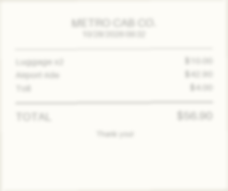
